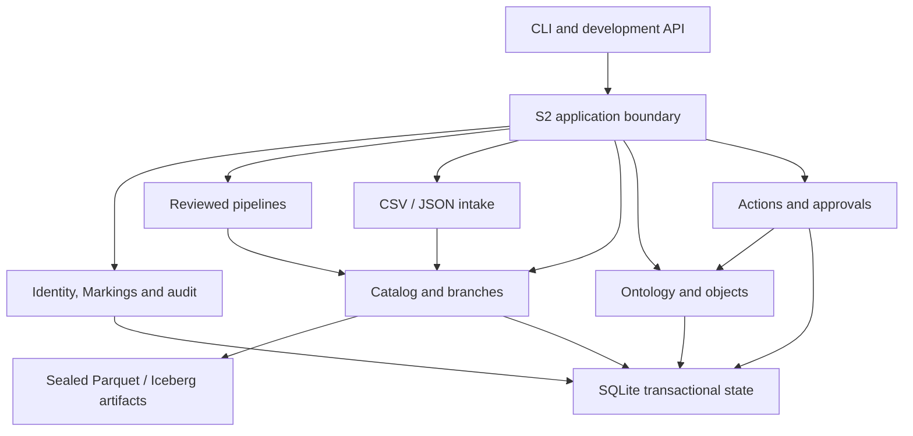

<div align="center">

# Samanvaya 2

### Enterprise Data Operating System & Operational Ontology Platform

**Governed data · Versioned Ontology · Transactional Actions**

`v0.7.0` · `Gate 1 reference foundation` · `590 tests passed locally` · `Proprietary commercial software`

[Architecture](docs/architecture/platform-overview.md) · [Tech stack](docs/TECH_STACK.md) · [Technical document](docs/TECHNICAL_OVERVIEW.md) · [Quick start](docs/guides/QUICKSTART.md) · [Documents & presentations](docs/resources/README.md)

</div>

---

## What we are building

Samanvaya 2 (**S2**) brings enterprise datasets, operational objects, business rules and governed Actions into one versioned platform. Its purpose is to connect what an organization knows with the decisions and workflows it can authorize, execute and audit.

The long-term architecture targets capabilities associated with **Palantir Foundry and AIP** across data integration, branching, semantic Ontology, operational applications and governed AI. S2 is independently developed proprietary software. Architectural parity is an engineering objective; the current implementation is the foundation described below.

**Intended domains:** autonomous fleet operations, aerospace and systems engineering, energy and utilities, heavy manufacturing, logistics and critical infrastructure. Domain packages are planned; the current demonstration uses synthetic manufacturing data.

**Deployment direction:** cloud SaaS, dedicated customer VPCs and air-gapped enterprise installations. Today's runnable implementation is a local, single-node reference platform.

## Current milestone

| Area | Available in v0.7.0 |
| --- | --- |
| **Governance** | Tenant/project isolation, roles, classification levels and compartments, property redaction and live restrictions across branches |
| **Versioned data** | JSON, local Parquet and local Iceberg v2 snapshots; staged APPEND/UPDATE/DELETE transactions; retry-safe COMMIT |
| **Branching** | Immutable cross-resource manifests, isolated forks, expected-head publication and conservative three-way merges |
| **Ontology** | Typed object schemas, interfaces, typed links, object revisions and permission-filtered reads |
| **Source bindings** | Bounded atomic dataset-to-object builds, pinned provenance, source-field ownership and live source-policy propagation |
| **Actions** | Atomic edits across multiple objects, distinct-admin approval quorum and execution-time revalidation |
| **Evidence** | Per-tenant hash-chained audit records, snapshot integrity checks and a read-only storage recovery report |
| **Developer access** | Python application boundary, CLI, loopback development API and synthetic end-to-end demo |

**Validation baseline — 15 November 2026:** 104 tests passed locally across JSON, Parquet and Iceberg. The Iceberg demo completed an internal Action, verified its audit chain and reported no broken or unreferenced artifacts. See the [validation record](docs/operations/storage-validation.md) for coverage and limits. This is functional validation, not a performance or production-readiness claim.

**Bindings validation — 17 November 2026:** 164 tests passed locally with storage suites required: the original 104 plus 60 binding tests across JSON, Parquet and Iceberg. See [binding contracts](docs/architecture/ontology-bindings.md) and the [session checkpoint](docs/operations/session-checkpoint-2026-11-17.md).

**Reconciliation update:** explicit administrator-reviewed retention of missing source objects and same-identity source return are now available. That milestone passed 197 tests, including 33 reconciliation tests. See [source reconciliation](docs/architecture/source-reconciliation.md).

**Reviewed merge update:** source scenarios can now publish coherent bindings and derived objects through a preview hash and atomic two-parent commit. Same-object conflicts remain explicit. See [merge contracts](docs/architecture/reviewed-merges.md).

**Migration capability:** compatible schema adoption and reviewed source remapping now publish bindings and objects atomically. The current full suite has 590 passing tests. See [migration contracts](docs/architecture/binding-migrations.md).

## Architecture at a glance



The application boundary validates current authorization and coordinates the transaction. Dataset files are prepared, sealed and verified **before** their descriptor is published with the branch head and audit entry. Branches refer to immutable revisions, so a new snapshot does not overwrite the data used by an older branch.

[Explore the platform architecture →](docs/architecture/platform-overview.md) · [Read the file-storage protocol →](docs/architecture/file-storage.md)

## Ten-subsystem platform

Six subsystem packages currently contain executable foundation code. The remaining four contain architecture scaffolds for subsequent delivery.

| Subsystem | Responsibility | Status |
| --- | --- | --- |
| [Connector Fabric](subsystems/s2-connector-fabric/README.md) | Enterprise connectors, CDC, offline agents and automated schema discovery | Local CSV/JSON intake implemented; broader connectors planned |
| [Catalog & Storage](subsystems/s2-catalog-storage/README.md) | Dataset transactions, snapshots, branch manifests and publication | Implemented reference |
| [Compute & Pipelines](subsystems/s2-compute-pipelines/README.md) | Pipeline DAGs, transformation execution and Data Health | Bounded projection/filter execution and health checks; DAG/UI planned |
| [Ontology Kernel](subsystems/s2-ontology-kernel/README.md) | Types, interfaces, links, object state and the OSv2 foundation | Implemented reference |
| [Kinetic Actions](subsystems/s2-kinetic-actions/README.md) | Validated mutations, approvals and transactional execution | Implemented reference |
| [OSDK Generator](subsystems/s2-osdk-generator/README.md) | Schema-derived TypeScript, Python and Java clients | Planned |
| [Workshop Studio](subsystems/s2-workshop-studio/README.md) | Low-code operational applications and custom application runtime | Planned |
| [Analytics Workbench](subsystems/s2-analytics-workbench/README.md) | Tabular, object and time-series analysis | Planned |
| [AIP Runtime](subsystems/s2-aip-runtime/README.md) | Ontology-grounded AI Logic, Automate, local models and Evals | Planned |
| [Governance Control](subsystems/s2-governance-control/README.md) | Access controls, Markings and audit; future lineage and licensing | Implemented foundation |

[Detailed capability status →](docs/parity-matrix/gate1.md)

## Technology stack

| Layer | Current implementation |
| --- | --- |
| Runtime | Python 3.11+; local validation on Python 3.13 |
| Transactional catalog | SQLite WAL, immutable JSON manifests and content-digested revisions |
| File-backed datasets | PyArrow **26.0.1**, PyIceberg **0.10.0**, SQLAlchemy **2.1.8** |
| Data formats | Canonical JSON, Parquet, Iceberg v2 metadata and Avro manifests |
| Authorization | First-party roles, project membership, classification and compartment checks |
| Development interface | Python service facade, CLI and standard-library loopback HTTP server |
| Testing & packaging | `unittest`, failure injection, subprocess crash tests, setuptools and GitHub Actions configuration |

[Full stack, dependency boundaries and planned components →](docs/TECH_STACK.md)

## Run the storage demo

From the repository root, with Python 3.11 or later:

```bash
python3 -m venv .venv
.venv/bin/python -m pip install -r requirements-storage.lock
S2_REQUIRE_STORAGE_TESTS=1 .venv/bin/python -m unittest discover -s tests -v
.venv/bin/python tooling/s2.py --db .local/iceberg-demo.db --storage iceberg demo
.venv/bin/python tooling/s2.py --db .local/iceberg-demo.db storage-report
```

Expected results: **590 passing tests**, Action status `COMMITTED`, audit `valid: true` and an empty `broken_references` list. A fresh successful demo also has no unreferenced artifacts. Each demo creates a new synthetic tenant; it sends no external commands and prints no authentication token.

For the dependency-free JSON demonstration:

```bash
python3 tooling/s2.py --db .local/json-demo.db demo
```

Initial installation of the storage dependencies requires package access. Once installed, these reference backends run locally. Use the [quick-start guide](docs/guides/QUICKSTART.md) for API startup, backend selection and existing-database precautions.

## Technical reading room

| Document | What it explains |
| --- | --- |
| [Technical overview](docs/TECHNICAL_OVERVIEW.md) | End-to-end behaviour, contracts, invariants and implementation limits |
| [Platform architecture](docs/architecture/platform-overview.md) | Subsystem boundaries, trust boundaries and publication flow |
| [Technology stack](docs/TECH_STACK.md) | Implemented technologies, dependency versions and planned additions |
| [Branch-aware metamodel](docs/metamodel/gate1.md) | Persisted entities, immutable revisions and live security policy |
| [Storage design](docs/architecture/file-storage.md) | Parquet/Iceberg artifacts, durability ordering and recovery |
| [API reference](docs/api-contracts/gate1.md) | Development operations, parameters and errors |
| [Validation evidence](docs/operations/storage-validation.md) | Test coverage and what has been demonstrated |
| [Roadmap](docs/ROADMAP.md) | Next delivery milestones and acceptance evidence |
| [Documents & presentations](docs/resources/README.md) | Planned home for reviewed Word, PDF and PowerPoint materials |

[Browse the documentation index →](docs/README.md)

## Governed file ingestion

Local CSV/JSON intake now supports schema validation, rejected-record reports, reviewed atomic APPEND, receipt lookup and replay safety. See [ingestion contract](docs/architecture/file-ingestion.md).

```bash
.venv/bin/python tooling/ingestion_demo.py --storage iceberg
```

## Versioned pipeline execution

Reviewed projection/filter runs now publish pinned output snapshots with range/count checks and provenance. See [pipeline contract](docs/architecture/versioned-pipelines.md), including format-6 compatibility. Reviewed pipeline-bearing merges are now supported; see [merge validation](docs/architecture/pipeline-merges.md).

```bash
.venv/bin/python tooling/pipeline_demo.py --storage iceberg --merge
```

## Dependency-aware pipeline chains

Reviewed chains simulate downstream outputs in memory and execute in dependency order within one catalog transaction. Later-stage failures roll back earlier stages. See [contract](docs/architecture/pipeline-orchestration.md).

```bash
.venv/bin/python tooling/orchestration_demo.py --storage iceberg
```

## Governed lineage inspection

Trace exact object, binding, dataset and pipeline revisions through a permission-checked provenance graph. See [scope and API](docs/architecture/governed-lineage.md).

```bash
.venv/bin/python tooling/orchestration_demo.py --storage iceberg --lineage
```

## Next development milestone

**Broader transforms and operational interfaces.** Bounded materialization, retained-absence reconciliation and reviewed compatible binding migration are implemented. General merge resolution, migration of missing objects, general schema evolution and scheduled/remote ingestion remain next steps. See [the implemented contract](docs/architecture/ontology-bindings.md).

Subsequent milestones cover connector/pipeline execution, typed SDKs, operational application builders and governed AI. The [roadmap](docs/ROADMAP.md) distinguishes these planned capabilities from today's executable code.

## Engineering boundaries

- File backends write complete local snapshots. Distributed catalogs, object-store integration, incremental file reuse and performance qualification remain future work.
- OSv2 currently provides authoritative transactional object state. Billion-object scale, vector/spatial/media/time-series indexing and sub-100 ms performance are not claimed.
- Actions currently support typed internal property edits. Sandboxed user Functions, remote write-back and controller integration are planned.
- Production SSO/TLS, key management, HA, signed offline releases, license enforcement and independent audit anchors remain to be implemented.
- A database using file storage must be backed up with its pinned warehouse. Iceberg metadata contains absolute paths; relocation and application downgrade require a designed migration.

See [security guidance](SECURITY.md) and the [implementation status matrix](docs/parity-matrix/gate1.md) before planning a deployment.

---

**Copyright © 2026 Veerendra Kiran Bidarkota. All Rights Reserved — Proprietary Commercial Software.**

Use and distribution are governed by [LICENSE](LICENSE). Third-party components retain their own licenses; see [THIRD_PARTY_NOTICES.md](THIRD_PARTY_NOTICES.md). Palantir product names are architectural references; no affiliation, technology license or achieved product equivalence is asserted.

### Imaging evidence through S2 bindings

From this checkout on the ontology-bindings branch, run the local demonstration with a sibling S0.7 checkout at `e4d08a5` or later containing the benchmark reports:

```sh
python3 tooling/imaging_evidence_demo.py ../S0.7
```

The demo reads six baseline reports and the ePoikf replay CSV, writes four datasets through the S2 transaction API, materializes typed objects, and queries their links. Each CodecRun links to its Collection, CodecBuild and EvidenceReport. Source report hashes identify the imported evidence. The six baselines yield 32 misses across 900 frames; the two replays have their own records and are excluded from the baseline total. The JSON-backed database is temporary and removed on exit. S0.7 owns this benchmark format; the generic storage and ontology services are unchanged.

To retain this evidence between sessions, select a new private state directory outside the checkout:

```sh
state="$HOME/.local/share/samanvaya/imaging-evidence-v1"
python3 tooling/imaging_evidence_demo.py ../S0.7 --store "$state"
python3 tooling/imaging_evidence_demo.py --query "$state"
```

An identical import reuses the snapshot. Changed reports require a new directory.
The query opens the saved ontology with a project viewer credential and requires no S0.7 checkout.
Keep the state directory private: it contains the local database and viewer credential.

### Evaluate a local model against saved imaging evidence

With the imaging snapshot above and Ollama running locally, try:

```sh
python3 tooling/imaging_assistant.py "$state" --model mistral:latest
```

The pilot asks whether the two ePoikf replays erased the original misses. The viewer query supplies the selected clip's original counts, each replay's counts and citations, and the total across all six original runs. The CLI prints these as `verified_measurements`. Ollama receives the selected evidence without credentials or callable tools. It interprets whether the original observation survives and whether both replays had zero misses. The CLI checks both claims, reports the model digest and elapsed time, and exits with 0 for a match, 2 for a mismatch or 1 for an execution error. A pass covers this one question.

Use `--case cause` to ask what caused the ePoikf miss pattern. The viewer supplies counts and references. Those observations alone cannot establish CPU scheduling, thermal conditions or frame content as the cause. This case checks whether a model reports that uncertainty. The default case remains `replay`.

Display `reviewer_answer.summary` and `reviewer_answer.reports` together. Both come from the selected viewer records. The diagnostic fields `model_interpretation` and `passed` retain the model response and its evaluation even when the model guesses a cause.

For a cited answer without running a model, use the same saved viewer snapshot:

```sh
python3 tooling/imaging_assistant.py "$state" --review-only --case cause
```

This command prints the summary and source report paths. Exit code 0 means the evidence query and rendering succeeded. Use `--case replay` for the original observation question.

To list original collections with deadline misses, run `python3 tooling/imaging_assistant.py "$state" --list-misses`. Each row includes a miss count, frame count and report path. Rows are ordered by descending miss count with ties ordered by collection name. Totals cover all six originals, including zero-miss runs. This viewer query runs independently of Ollama and replay records.

Use `python3 tooling/imaging_assistant.py "$state" --collection flirv_ePoikf` to inspect one collection by its exact ID. Each visible run includes its series, miss and frame counts, codec build key and source report. Two replays that share a report appear as separate runs. This query runs locally without Ollama.

Follow the build key from any collection with `python3 tooling/imaging_assistant.py "$state" --build 2312a7a63c2e`. A full key or a unique prefix selects the build among visible runs. The result lists each run with its source report and totals grouped by series.

To trace a citation back to the runs that use it, copy its exact recorded path into `--report`. For example, `python3 tooling/imaging_assistant.py "$state" --report benchmarks/flir-epoikf-repeat/frame-times.csv` returns the two ePoikf replays with their series, counts and build keys. The lookup uses the saved viewer snapshot and does not open the source file.

Add `--verify-file /path/to/local/copy` to a `--report` lookup to compare the local bytes with the SHA-256 recorded at import. The JSON includes both digests and a `matches` flag. Exit codes are 0 for a match, 2 for different bytes and 1 for an unavailable file or report.

### Review recorded input resolution

From the S.2a checkout, create a new snapshot and query the compression requirement:

```sh
state="$HOME/.local/share/samanvaya/imaging-evidence-v2"
python tooling/imaging_evidence_demo.py ../S0.7 --store "$state"
python tooling/imaging_assistant.py "$state" --requirement compression-input-resolution
```

The query lists the encoder input dimensions recorded in each original report's `encoder_args` (`-W` and `-H`), the source path and digest, and any replays of that collection. Missing or ambiguous dimensions and older snapshots yield `unknown`. These dimensions describe the encoder configuration. The requirement specifies approximately 1920 × 1200 pixels. Acceptance remains unassessed pending a defined tolerance.

The resolution query reads requirement wording from the linked snapshot records. Older snapshots without this link return JSON null for the wording.

Run `python tooling/imaging_assistant.py "$state" --verify-reports ../S0.7` to verify every distinct report cited by visible runs. The command checks shared files once and reports missing or changed files individually. Exit code 0 means all cited files matched, 2 flags individual failures, and 1 indicates the audit could not start.

For a short terminal review, run `python tooling/imaging_assistant.py "$state" --summary ../S0.7`. Counts come from the saved snapshot. Source verification checks the current files and returns exit code 2 for individual failures. Resolution acceptance is reported separately.

The [compression benchmark review](docs/reviews/Samanvaya-compression-review.md) includes per-run citations and file verification results. From the repository root, refresh the tracked report after a successful verification:

```sh
review=docs/reviews/Samanvaya-compression-review.md
tmp_review=$(mktemp) &&
python tooling/imaging_assistant.py "$state" --summary ../S0.7 --markdown > "$tmp_review" &&
mv "$tmp_review" "$review"
```

Check the tracked review from an existing snapshot with `tooling/check_compression_review.sh "$state" ../S0.7`. The check verifies the cited files, regenerates the Markdown in a temporary file, and compares its bytes with the tracked copy. A source verification failure or a difference in the review returns a nonzero exit status.

### Record a resolution review decision

Create a separate local review-enabled snapshot. Its private reviewer.token file grants project editor access. Keep it with the designated local reviewer and outside Git. The receipt identifies the authenticated project principal and records UTC time, the evidence commit, requirement wording and report digests.

```sh
review_state="$HOME/.local/share/samanvaya/imaging-review-v3"
python tooling/imaging_evidence_demo.py ../S0.7 --store "$review_state" --enable-review
python tooling/imaging_review_decision.py "$review_state" --credential "$review_state/reviewer.token" --open "Coverage near 1920 × 1200 remains open."
python tooling/imaging_review_decision.py "$review_state"
```

Recording the same decision twice returns the original receipt. The viewer can reopen it after restart. A new evidence snapshot has its own review.

Compare two snapshots with `python tooling/imaging_assistant.py OLDER_STATE --compare-to NEWER_STATE`. Each snapshot is read with its own viewer credential. The comparison matches visible runs by collection and series and compares counts, build, encoder dimensions, report path and recorded digest. A null side means the run was visible in only one input. This check compares saved run evidence independently of branch IDs, review decisions and the current source checkout.

Use `python tooling/imaging_review_decision.py REVIEW_STATE --compare-evidence OTHER_STATE` to compare the recorded decision with the other viewer’s visible requirement wording and report path/digest pairs. A replaced report appears on both sides with its respective digest. Additional reports are listed even if every earlier report still matches.

Reopening a decision checks current viewer access to the cited objects and their recorded fields. The complete receipt is available only while the viewer can read those fields.

### Import an additional compression collection

Pass `--extra-report PATH` when importing into a fresh snapshot, once per additional collection. Use paths relative to S0.7 pointing to completed `s07.codec-run.v1` fixed-2mbps reports. Each baseline must have a distinct collection ID. The requirement query includes the new collections. The fixed six-clip assistant evaluation retains its original scope. Encoder settings describe the recorded input dimensions. Claims about native capture resolution require acquisition metadata.

The [seven-collection compression review](docs/reviews/Samanvaya-compression-review-v4.md) adds the 1920 × 1080 Crowd Run visible-luma benchmark to the six FLIR originals. Reproduce it from the S.2a checkout:

```sh
tooling/check_compression_review.sh "$HOME/.local/share/samanvaya/imaging-evidence-v4" ../S0.7 docs/reviews/Samanvaya-compression-review-v4.md
```
