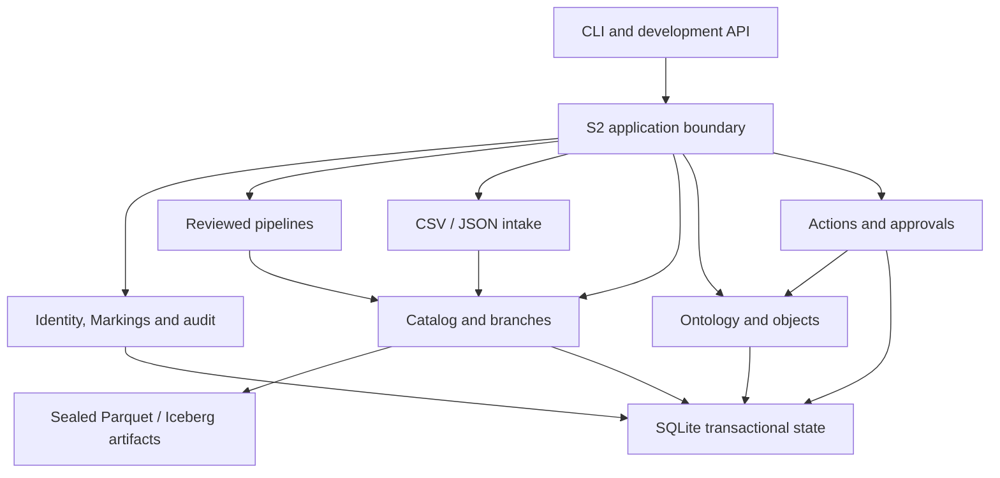

<div align="center">

# Samanvaya 2

### Enterprise Data Operating System & Operational Ontology Platform

**Governed data · Versioned Ontology · Transactional Actions**

`v0.5.1` · `Gate 1 reference foundation` · `482 tests passed locally` · `Proprietary commercial software`

[Architecture](docs/architecture/platform-overview.md) · [Tech stack](docs/TECH_STACK.md) · [Technical document](docs/TECHNICAL_OVERVIEW.md) · [Quick start](docs/guides/QUICKSTART.md) · [Documents & presentations](docs/resources/README.md)

</div>

---

## What we are building

Samanvaya 2 (**S2**) brings enterprise datasets, operational objects, business rules and governed Actions into one versioned platform. Its purpose is to connect what an organization knows with the decisions and workflows it can authorize, execute and audit.

The long-term architecture targets capabilities associated with **Palantir Foundry and AIP** across data integration, branching, semantic Ontology, operational applications and governed AI. S2 is independently developed proprietary software. Architectural parity is an engineering objective; the current implementation is the foundation described below.

**Intended domains:** autonomous fleet operations, aerospace and systems engineering, energy and utilities, heavy manufacturing, logistics and critical infrastructure. Domain packages are planned; the current demonstration uses synthetic manufacturing data.

**Deployment direction:** cloud SaaS, dedicated customer VPCs and air-gapped enterprise installations. Today's runnable implementation is a local, single-node reference platform.

## Current milestone

| Area | Available in v0.5.1 |
| --- | --- |
| **Governance** | Tenant/project isolation, roles, classification levels and compartments, property redaction and live restrictions across branches |
| **Versioned data** | JSON, local Parquet and local Iceberg v2 snapshots; staged APPEND/UPDATE/DELETE transactions; retry-safe COMMIT |
| **Branching** | Immutable cross-resource manifests, isolated forks, expected-head publication and conservative three-way merges |
| **Ontology** | Typed object schemas, interfaces, typed links, object revisions and permission-filtered reads |
| **Source bindings** | Bounded atomic dataset-to-object builds, pinned provenance, source-field ownership and live source-policy propagation |
| **Actions** | Atomic edits across multiple objects, distinct-admin approval quorum and execution-time revalidation |
| **Evidence** | Per-tenant hash-chained audit records, snapshot integrity checks and a read-only storage recovery report |
| **Developer access** | Python application boundary, CLI, loopback development API and synthetic end-to-end demo |

**Validation baseline — 15 November 2026:** 104 tests passed locally across JSON, Parquet and Iceberg. The Iceberg demo completed an internal Action, verified its audit chain and reported no broken or unreferenced artifacts. See the [validation record](docs/operations/storage-validation.md) for coverage and limits. This is functional validation, not a performance or production-readiness claim.

**Bindings validation — 17 November 2026:** 164 tests passed locally with storage suites required: the original 104 plus 60 binding tests across JSON, Parquet and Iceberg. See [binding contracts](docs/architecture/ontology-bindings.md) and the [session checkpoint](docs/operations/session-checkpoint-2026-11-17.md).

**Reconciliation update:** explicit administrator-reviewed retention of missing source objects and same-identity source return are now available. That milestone passed 197 tests, including 33 reconciliation tests. See [source reconciliation](docs/architecture/source-reconciliation.md).

**Reviewed merge update:** source scenarios can now publish coherent bindings and derived objects through a preview hash and atomic two-parent commit. Same-object conflicts remain explicit. See [merge contracts](docs/architecture/reviewed-merges.md).

**Migration capability:** compatible schema adoption and reviewed source remapping now publish bindings and objects atomically. The current full suite has 482 passing tests. See [migration contracts](docs/architecture/binding-migrations.md).

## Architecture at a glance



The application boundary validates current authorization and coordinates the transaction. Dataset files are prepared, sealed and verified **before** their descriptor is published with the branch head and audit entry. Branches refer to immutable revisions, so a new snapshot does not overwrite the data used by an older branch.

[Explore the platform architecture →](docs/architecture/platform-overview.md) · [Read the file-storage protocol →](docs/architecture/file-storage.md)

## Ten-subsystem platform

Six subsystem packages currently contain executable foundation code. The remaining four contain architecture scaffolds for subsequent delivery.

| Subsystem | Responsibility | Status |
| --- | --- | --- |
| [Connector Fabric](subsystems/s2-connector-fabric/README.md) | Enterprise connectors, CDC, offline agents and automated schema discovery | Local CSV/JSON intake implemented; broader connectors planned |
| [Catalog & Storage](subsystems/s2-catalog-storage/README.md) | Dataset transactions, snapshots, branch manifests and publication | Implemented reference |
| [Compute & Pipelines](subsystems/s2-compute-pipelines/README.md) | Pipeline DAGs, transformation execution and Data Health | Bounded projection/filter execution and health checks; DAG/UI planned |
| [Ontology Kernel](subsystems/s2-ontology-kernel/README.md) | Types, interfaces, links, object state and the OSv2 foundation | Implemented reference |
| [Kinetic Actions](subsystems/s2-kinetic-actions/README.md) | Validated mutations, approvals and transactional execution | Implemented reference |
| [OSDK Generator](subsystems/s2-osdk-generator/README.md) | Schema-derived TypeScript, Python and Java clients | Planned |
| [Workshop Studio](subsystems/s2-workshop-studio/README.md) | Low-code operational applications and custom application runtime | Planned |
| [Analytics Workbench](subsystems/s2-analytics-workbench/README.md) | Tabular, object and time-series analysis | Planned |
| [AIP Runtime](subsystems/s2-aip-runtime/README.md) | Ontology-grounded AI Logic, Automate, local models and Evals | Planned |
| [Governance Control](subsystems/s2-governance-control/README.md) | Access controls, Markings and audit; future lineage and licensing | Implemented foundation |

[Detailed capability status →](docs/parity-matrix/gate1.md)

## Technology stack

| Layer | Current implementation |
| --- | --- |
| Runtime | Python 3.11+; local validation on Python 3.13 |
| Transactional catalog | SQLite WAL, immutable JSON manifests and content-digested revisions |
| File-backed datasets | PyArrow **26.0.1**, PyIceberg **0.10.0**, SQLAlchemy **2.1.8** |
| Data formats | Canonical JSON, Parquet, Iceberg v2 metadata and Avro manifests |
| Authorization | First-party roles, project membership, classification and compartment checks |
| Development interface | Python service facade, CLI and standard-library loopback HTTP server |
| Testing & packaging | `unittest`, failure injection, subprocess crash tests, setuptools and GitHub Actions configuration |

[Full stack, dependency boundaries and planned components →](docs/TECH_STACK.md)

## Run the storage demo

From the repository root, with Python 3.11 or later:

```bash
python3 -m venv .venv
.venv/bin/python -m pip install -r requirements-storage.lock
S2_REQUIRE_STORAGE_TESTS=1 .venv/bin/python -m unittest discover -s tests -v
.venv/bin/python tooling/s2.py --db .local/iceberg-demo.db --storage iceberg demo
.venv/bin/python tooling/s2.py --db .local/iceberg-demo.db storage-report
```

Expected results: **482 passing tests**, Action status `COMMITTED`, audit `valid: true` and an empty `broken_references` list. A fresh successful demo also has no unreferenced artifacts. Each demo creates a new synthetic tenant; it sends no external commands and prints no authentication token.

For the dependency-free JSON demonstration:

```bash
python3 tooling/s2.py --db .local/json-demo.db demo
```

Initial installation of the storage dependencies requires package access. Once installed, these reference backends run locally. Use the [quick-start guide](docs/guides/QUICKSTART.md) for API startup, backend selection and existing-database precautions.

## Technical reading room

| Document | What it explains |
| --- | --- |
| [Technical overview](docs/TECHNICAL_OVERVIEW.md) | End-to-end behaviour, contracts, invariants and implementation limits |
| [Platform architecture](docs/architecture/platform-overview.md) | Subsystem boundaries, trust boundaries and publication flow |
| [Technology stack](docs/TECH_STACK.md) | Implemented technologies, dependency versions and planned additions |
| [Branch-aware metamodel](docs/metamodel/gate1.md) | Persisted entities, immutable revisions and live security policy |
| [Storage design](docs/architecture/file-storage.md) | Parquet/Iceberg artifacts, durability ordering and recovery |
| [API reference](docs/api-contracts/gate1.md) | Development operations, parameters and errors |
| [Validation evidence](docs/operations/storage-validation.md) | Test coverage and what has been demonstrated |
| [Roadmap](docs/ROADMAP.md) | Next delivery milestones and acceptance evidence |
| [Documents & presentations](docs/resources/README.md) | Planned home for reviewed Word, PDF and PowerPoint materials |

[Browse the documentation index →](docs/README.md)

## Governed file ingestion

Local CSV/JSON intake now supports schema validation, rejected-record reports, reviewed atomic APPEND, receipt lookup and replay safety. See [ingestion contract](docs/architecture/file-ingestion.md).

```bash
.venv/bin/python tooling/ingestion_demo.py --storage iceberg
```

## Versioned pipeline execution

Reviewed projection/filter runs now publish pinned output snapshots with range/count checks and provenance. See [pipeline contract](docs/architecture/versioned-pipelines.md), including format-6 compatibility. Reviewed pipeline-bearing merges are now supported; see [merge validation](docs/architecture/pipeline-merges.md).

```bash
.venv/bin/python tooling/pipeline_demo.py --storage iceberg --merge
```

## Next development milestone

**Pipeline orchestration and broader transforms.** Bounded materialization, retained-absence reconciliation and reviewed compatible binding migration are implemented. General merge resolution, migration of missing objects, general schema evolution and scheduled/remote ingestion remain next steps. See [the implemented contract](docs/architecture/ontology-bindings.md).

Subsequent milestones cover connector/pipeline execution, typed SDKs, operational application builders and governed AI. The [roadmap](docs/ROADMAP.md) distinguishes these planned capabilities from today's executable code.

## Engineering boundaries

- File backends write complete local snapshots. Distributed catalogs, object-store integration, incremental file reuse and performance qualification remain future work.
- OSv2 currently provides authoritative transactional object state. Billion-object scale, vector/spatial/media/time-series indexing and sub-100 ms performance are not claimed.
- Actions currently support typed internal property edits. Sandboxed user Functions, remote write-back and controller integration are planned.
- Production SSO/TLS, key management, HA, signed offline releases, license enforcement and independent audit anchors remain to be implemented.
- A database using file storage must be backed up with its pinned warehouse. Iceberg metadata contains absolute paths; relocation and application downgrade require a designed migration.

See [security guidance](SECURITY.md) and the [implementation status matrix](docs/parity-matrix/gate1.md) before planning a deployment.

---

**Copyright © 2026 Veerendra Kiran Bidarkota. All Rights Reserved — Proprietary Commercial Software.**

Use and distribution are governed by [LICENSE](LICENSE). Third-party components retain their own licenses; see [THIRD_PARTY_NOTICES.md](THIRD_PARTY_NOTICES.md). Palantir product names are architectural references; no affiliation, technology license or achieved product equivalence is asserted.
