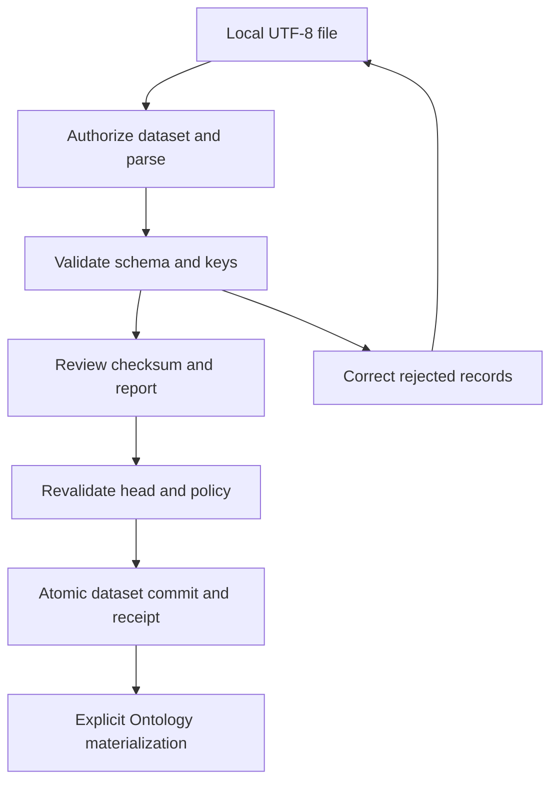

# Governed file ingestion — v0.4.0

The connector fabric now has a bounded local CSV/JSON intake path. It previews records against an existing explicit dataset schema, rejects invalid batches and publishes valid APPEND batches through the existing transactional dataset engine. It does not infer a schema or execute a connector against an external system.

## How it works



A CSV record number counts data records, not physical file lines: a quoted field can span lines. JSON uses a top-level array of objects, one object per record. Preview returns counts, record numbers and error codes, without raw row values. Syntax/shape errors reject the whole request. Authorization errors fail the operation instead of revealing which hidden key exists.

## Input and validation rules

| Area | Contract |
| --- | --- |
| Dataset | Must already exist with required string/integer primary key |
| Operation | APPEND only; no upsert, update, deletion or partial acceptance |
| Bounds | At most 1 MiB UTF-8 content and 1,000 records per request; CSV parser field limits also apply |
| JSON | Strict JSON; duplicate properties and NaN/Infinity tokens rejected; native scalar types must match schema |
| CSV | Unique nonempty headers, matching record widths, quoted fields supported; unknown columns rejected |
| Integer CSV cell | Canonical decimal integer, optional minus; no whitespace, leading zeros or decimal fraction |
| Number CSV cell | Python numeric conversion followed by finite-number validation |
| Boolean CSV cell | Exactly `true` or `false` |
| Empty optional CSV cell | Property omitted; explicit empty optional strings require JSON |
| Empty required string | Allowed by the current scalar schema; no minimum-length rule is inferred |
| Duplicate key | Existing-dataset collision or repeated input key rejects publication |
| Classification | Explicit batch label plus live row floors; caller must access full schema and existing rows |

`valid_records` counts individually accepted records, but **none** are published when `rejected_records` is nonzero. Correct the input and obtain another preview. Error codes are `SCHEMA_VALIDATION` and `DUPLICATE_KEY`. This is a transient rejection report, not a durable quarantine or a raw-file archive. Preview audit events record the operation outcome, not rejected row contents.

## API

All operations use normal authenticated tenant/project authorization. Preview/apply require write permission. Receipt retrieval requires read permission and the original importing actor.

| Operation | Parameters | Result |
| --- | --- | --- |
| `ingestion.preview` | `branch`, `expected_head`, `dataset`, `content`, `format`, `source_name`, optional `label` | Base commit/dataset revision, source SHA-256, bytes/counts/errors, `can_publish`, `plan_hash` |
| `ingestion.apply` | Same exact input plus `plan_hash`, `idempotency_key` | Committed dataset snapshot/commit, transaction, run ID and receipt |
| `ingestion.get` | `branch`, `run` | Original committed receipt after current-policy authorization |

The preview hash binds actor, source identity/content checksum, base head, schema, effective source policies and prospective rows. Changes to file contents, source name, head or effective policy require a new preview. Source name is an informational label, not an authenticated statement of origin. The content checksum covers exact UTF-8 bytes, including line endings; CLI reads bytes before decoding.

Publication uses the existing dataset begin/prepare/commit logic within one Service transaction. Dataset publication, transaction record, ingestion receipt and audit succeed or roll back together. Retry the exact request with the same key to recover the committed result without appending again. Replays and receipt reads recheck current authorization on the pinned resulting snapshot. Receipt lookup is scoped to tenant, branch and importing principal. No token or original input text is stored in the receipt.

The operational `ingestion_runs` table holds tenant, branch, run ID, actor, idempotency key, request hash and result. Unique keys are `(tenant, branch, idem)` and `(tenant, branch, id)`. Receipts reference committed snapshots; they are not branch-manifest resources and are not copied or re-executed by a branch merge. No catalog format bump is required. The local receipt is not a signed external provenance attestation.

## Local file commands

Use an existing authorized token in `S2_TOKEN`. Do not put the token in command-line arguments or check it into Git. Capture the current branch head, and substitute actual identifiers below. Preview and apply must use the same file, basename, head, format and label.

```bash
.venv/bin/python tooling/s2.py --db .local/s2.db ingest-preview \
  --file /path/to/equipment.csv --format csv \
  --branch BRANCH_ID --expected-head COMMIT_ID --dataset equipment

.venv/bin/python tooling/s2.py --db .local/s2.db ingest-apply \
  --file /path/to/equipment.csv --format csv \
  --branch BRANCH_ID --expected-head COMMIT_ID --dataset equipment \
  --plan-hash REVIEWED_PLAN_HASH --key equipment-import-001
```

Optional `--marking '{"level":2,"compartments":["ENG"]}'` must be supplied identically to both commands. Preview exits 1 when records are rejected; malformed requests or failures exit 2. Existing HTTP request-size limits still apply to the entire JSON envelope and can make the effective network payload limit smaller than 1 MiB. The service accepts supplied text; it never reads arbitrary server filesystem paths or fetches URLs.

## Demonstration and boundaries

```bash
.venv/bin/python tooling/ingestion_demo.py --storage iceberg
```

The synthetic demo previews an invalid reading, imports a two-row CSV, verifies retry/receipt equality, and explicitly materializes two Ontology objects. It verifies audit and storage references, makes no external calls and removes its temporary database.

This is the first executable connector-fabric slice. CDC, remote agents, scheduling, ERP/PLM adapters, schema inference, schema evolution, durable quarantine, partial acceptance, streaming and production-scale ingestion remain future work. For RCI/DRDO laboratory records, source ownership, customer-approved schemas and classification assignments still need project-specific agreement. No customer acceptance or production qualification is claimed.
