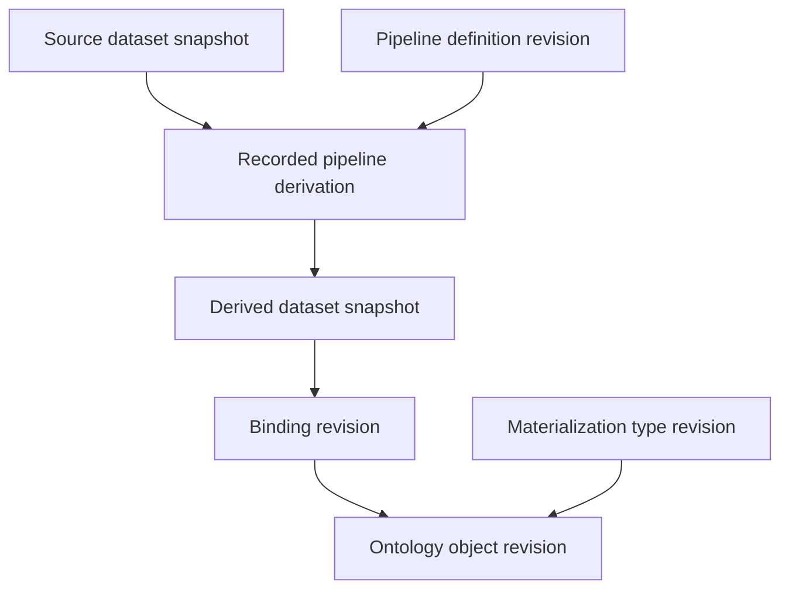

# Governed lineage inspection — S2 v0.7.0

`lineage.trace` returns a bounded graph of recorded provenance for an object or dataset at a pinned current branch head. It traces exact historical revisions through materialization bindings and pipeline stages. It reads existing records; it does not execute a pipeline, refresh an object or modify a branch.

## Operation

```json
{
  "operation": "lineage.trace",
  "params": {
    "branch": "BRANCH_ID",
    "expected_head": "CURRENT_COMMIT_ID",
    "resource": "object/OBJECT_ID",
    "max_nodes": 100,
    "max_depth": 32
  }
}
```

Use `dataset/DATASET_NAME` for a dataset root. Normal read-role, tenant/project and current classification rules apply. A stale requested head is rejected. Callers cannot supply arbitrary historical commit IDs: historical references come only from recorded provenance reachable from the chosen root.

| Response field | Meaning |
| --- | --- |
| branch / commit | Requested branch and pinned current head |
| root | Stable graph node ID for the selected resource revision |
| semantics | `recorded_provenance` |
| complete | Complete traversal within this defined provenance scope; limits cause an error rather than truncation |
| nodes | Authorized object, type, binding, dataset, pipeline and pipeline-derivation nodes |
| edges | Directed upstream-to-downstream relationships |

IDs are deterministic hashes of node kind, resource and revision. Nodes/edges are sorted for repeatable results. A pipeline derivation is identified by its output resource/revision; it is not a pipeline run receipt ID. It links an exact input snapshot and pipeline definition to an output carrying that recorded provenance.

## What is traversed



Multiple stages are followed recursively. A bound object uses its recorded binding, type and dataset revisions, even if the current branch has newer resources. Compatible binding migrations are supported: a newly written binding revision need not appear in its pre-migration base commit. The recorded dataset pin must still agree with that base commit.

Pipeline pins must agree with their recorded pre-run commit and definition references. Referenced commits must belong to the same tenant/project. History from a merged scenario is supported. A manual object has an object-to-schema relationship and no fabricated source binding.

Dataset nodes show authorized row counts and whether the revision matches the branch head's resource. Definition nodes also report `matches_branch_head`. Object nodes include their recorded source-presence status, or `UNRECORDED` when no presence record exists. Raw row values, operational values, approval notes, tokens and actor details are not returned.

## Authorization

Every visited dataset requires access to its complete schema and all rows. Every visited definition and object is checked using current policies, including live upstream dependencies on derived data. Object traces additionally require full access to the current object type and the pinned materialization type.

This is intentionally conservative: a caller who can see an object may still be unable to trace all of its upstream dataset. If any ancestor is inaccessible, the operation fails; no partial graph or hidden ancestor names/counts are returned. Admin role does not bypass clearance. The Service records its normal audit event for the request.

## Recorded provenance is not a freshness certificate

The graph reports what the stored records say about their sources. It does not rerun health checks or prove that output rows still equal the declared transform. Direct dataset edits can retain earlier `source_pipeline` metadata; those edges remain recorded provenance, not proof of a new successful pipeline run.

Likewise, later operational edits change the root object revision while preserving its materialization lineage. An older dataset pin is valid history, not automatically an error. `matches_branch_head: false` means that exact resource revision is not the branch's current one; it is not a full transitive freshness verdict. Use pipeline previews and reviewed merge validation for current transform consistency.

The current scope stops at source dataset snapshots. It does not traverse raw-file ingestion receipts, dataset-parent transaction history, Action approval history, absent-row reconciliation observations, model/LLM runs or Workshop widgets. Source-presence metadata does not change the recorded dataset that last materialized an object's values. This is a machine-readable API, not a graphical lineage UI or tamper-proof external attestation.

## Bounds and compatibility

Default maximum 100 nodes; callers may request 1–200. Dataset recursion depth defaults to 32 and accepts 1–32. Cycles, missing/inconsistent recorded references, inaccessible ancestors or exceeded limits fail the whole request. The node limit bounds graph output; source snapshots are still read and authorized in full, so this is not a large-data query engine.

No catalog format change, table migration or new dependency is introduced. Catalog format remains 6. Only audit records are appended by tracing; commits, revisions and run receipts remain unchanged.

## Demonstration

```bash
.venv/bin/python tooling/orchestration_demo.py --storage iceberg --lineage
```

The synthetic chain creates one bound object. Its lineage graph has 10 nodes and 9 edges: object, binding, materialization type, three dataset snapshots, two pipeline definitions and two recorded derivations. The demo verifies audit and storage references, produces no external effects and removes its temporary database.

This is local reference capability for traceable engineering records. RCI/DRDO schemas, access policy and customer acceptance remain separately agreed; full enterprise lineage coverage and production qualification are not implied.
