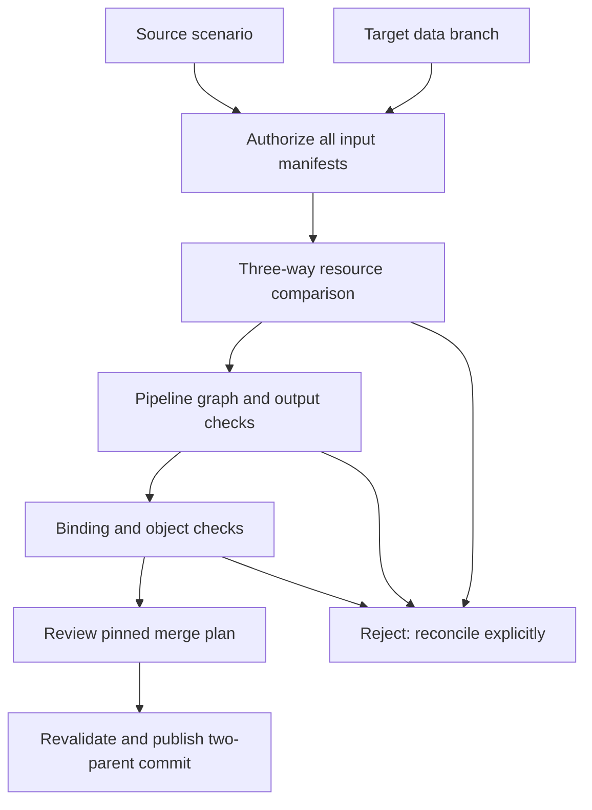

# Reviewed pipeline-aware branch merges — S2 v0.5.1

The reviewed merge API now accepts coherent pipeline-bearing manifests. It checks pipeline definitions, input snapshots, derived output snapshots and bound Ontology objects together before publishing one target commit. The legacy `branches.merge` endpoint remains blocked for pipelines; use `branches.merge_preview` and `branches.merge_reviewed`.

## Review flow

1. Fork a scenario from the target data branch.
2. Update source datasets or pipeline definitions explicitly.
3. Preview and execute affected pipelines in dependency order.
4. Rebuild affected Ontology bindings; reconcile missing source objects where needed.
5. Capture both branch heads and request `branches.merge_preview` with a review reason.
6. Review changed resource revisions and the returned `pipelines` proofs, then call `branches.merge_reviewed` with the same parameters, `plan_hash` and an idempotency key.



## What the coherence check proves

| Check | Required result |
| --- | --- |
| Writer ownership | At most one pipeline definition produces each output dataset |
| Definition graph | Acyclic; inspected in dependency order |
| References and schema pins | Existing input/output datasets with exact pinned schema hashes |
| Output provenance | Output names the current pipeline revision and exact merged input revision |
| Transform values | Stored output values equal the declared projection/filter result |
| Data health | Required output fields, inclusive numeric ranges and row counts pass |
| Classification | Stored output provenance is at least as restrictive as its static input classification |
| Live dependencies | Required input dataset/property/row and upstream dependencies remain recorded |
| Bound objects | Existing binding coherence checks confirm exact output snapshot pins and values |

The comparison recomputes expected values in memory. It does **not** execute or publish a pipeline run, create a dataset snapshot, repair output, or rematerialize objects. Row comparisons ignore ordering but preserve duplicates; identity remains governed by existing dataset and pipeline contracts. Preview creates no revision or commit, but normal API audit events are appended.

All pipeline definitions in the merged manifest must have coherent outputs, including unchanged definitions. Unrun or stale pipelines block the merge. This deliberately avoids silently promoting an incomplete branch. Competing definitions for one output are rejected even if one is intended to be inactive; there is no activation model in this slice.

## Preview and publication

The existing preview parameters remain unchanged: `branch`, `source`, `expected_head`, `expected_source`, `reason`. In addition to `changes`, the preview returns `pipelines`, ordered by dependencies. Each entry contains pipeline name/revision, input revision, output revision, output row count and `health: PASSED`. Non-pipeline merges return an empty list.

The plan hash includes this proof list, the proposed manifest, actor, pinned heads/reason and effective policies. Applying an old preview after a policy/head change fails. Output rows or classifications are never silently repaired. A successful apply creates a two-parent target commit and merge replay record in the same transaction as the success audit. The source branch is unchanged. Retrying the exact request returns the same result after current authorization checks.

Pipeline run receipts remain operational records on their original branches. A merge does not copy receipts to the target or rerun jobs. The target's dataset snapshots retain input/pipeline revision provenance, and the merge commit records the source head. Retrieve an original run receipt with its original branch and authorized importing actor.

## Authorization and conflicts

Admin role is required for the merge, but does not bypass clearance or project membership. The complete base/source/target manifests are authorized before resource names and conflict details are returned. Pipeline-level restrictions are explicitly checked, as are live source dependencies on derived datasets and objects.

Whole-resource conflict rules remain: two independently changed dataset snapshots, definitions or versions of the same object conflict. A source rebuild cannot silently overwrite a target operational edit. Resolve the branch contents explicitly and obtain a new preview. There is no row/property-level automatic reconciliation.

## Limits and compatibility

- At most 100 pipeline definitions per reviewed merged manifest.
- Existing pipeline bounds: at most 1,000 rows in each input/output snapshot.
- Existing binding bounds and direct-fork merge-base semantics still apply.
- No scheduler, automatic rebuild, distributed publication, multi-party merge approval queue, general rebase or criss-cross merge-base solver.
- Catalog format remains 6. This release adds validation and preview proofs without changing stored snapshot format.

The new path is local reference infrastructure, not customer acceptance or production qualification. It does not change Git operations. New pipeline-preview response fields should be tolerated by clients; callers must acquire fresh previews after upgrading because the merge plan hash now includes the proof list.

## Demonstration

```bash
.venv/bin/python tooling/pipeline_demo.py --storage iceberg --merge
```

The demo ingests laboratory readings, materializes a filtered object, records an inspection with a distinct approver, forks a scenario, refreshes the reading, reruns the pipeline and rebuilds the object. A reviewed merge publishes the new reading while preserving identity and approved status. It checks source immutability, replay equality, audit and storage integrity. Its temporary database is removed afterwards.
