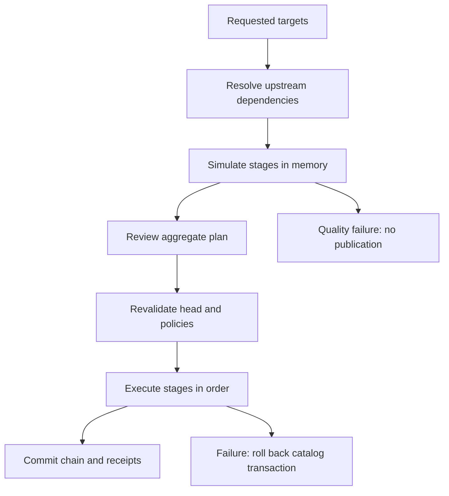

# Dependency-aware pipeline orchestration — S2 v0.6.0

This slice executes bounded pipeline dependency chains synchronously in the local reference runtime. A request names target pipelines; the engine includes upstream producers, previews their results in memory and publishes the reviewed chain in one catalog transaction. It is not a background scheduler or distributed job service.

## Selection and preview

The branch's pipeline-definition inventory must have unique output producers and no cycles. Target names are distinct and normalized; shared upstream stages run once. Only the selected dependency closure executes. The caller must access all inspected pipeline definitions and the complete input/prior-output snapshots of each simulated stage. An unrelated restricted, ambiguous or cyclic definition can therefore block planning. There is no active/inactive definition model.



Preview uses a read-through in-memory overlay: downstream stages see simulated upstream outputs. It creates no dataset files, catalog revisions, run receipts or branch commits. Normal API audit events may be appended.

| Stage status | Meaning |
| --- | --- |
| READY | Simulated transform and quality gates passed |
| FAILED | A simulated health gate failed |
| BLOCKED | Not simulated after an earlier failure |

The first health failure stops simulation; even independent later siblings are blocked because publication is all-or-nothing. Schema/authorization failures raise operation errors. Stage reports include pipeline revision, input/output names, row counts and errors. `preview_effect_hash` is a planning hash, not a persisted snapshot revision or a hash to submit directly to `pipelines.run`. Virtual references never become stored provenance.

## API and publication

| Operation | Role | Parameters |
| --- | --- | --- |
| orchestration.preview | Writer | branch, expected_head, targets |
| orchestration.run | Writer | Same plus plan_hash and idempotency_key |
| orchestration.get | Reader and original actor | branch, run |

The aggregate plan binds the actor, original head, normalized targets, definition inventory and simulated stage effects/policies. Changed heads, definitions, inputs or effective policies require a new preview. The idempotency key is a string of 1–200 characters.

Execution revalidates the plan and runs existing pipelines serially against real prior-stage outputs. Downstream input revisions reference actual upstream snapshot revisions. Every stage retains the existing projection/filter, schema, range and row-count checks.

**All stage catalog changes share one Service transaction.** Each stage creates its own history commit and run receipt, but the branch updates and receipts become visible together at transaction success. This is not a single history commit per chain. A later-stage failure or final audit failure rolls back every stage's catalog commit, head update and receipt, including the chain receipt.

File-backed snapshots may be sealed before publication. Failures can leave unreferenced physical artifacts; use the existing storage inventory/recovery mechanism. No automatic file deletion is added.

Each executed stage replaces its output rows. Review output ownership and row counts. There is no freshness-based skipping. Ontology materialization remains explicit after chain success.

## Receipts, retry and governance

The committed chain receipt contains run ID, actor/time, base/final commits, normalized targets/order, aggregate plan hash and complete stage results. Stage results retain pipeline/input/output revisions and stage commits. The operational `orchestration_runs` table is keyed by `(tenant, branch, idem)` and uniquely by `(tenant, branch, id)`; stage receipts remain in `pipeline_runs`.

Exact retries return the original receipt without rerunning stages. Reordering the same target set is accepted; changed actor/head/targets/plan under one key conflicts. Replay and receipt lookup recheck current authorization for every pinned stage. Normal tenant/project/clearance restrictions apply.

The orchestration Service call appends one aggregate success audit event. Internal stage method calls do not append separate Service audit events; receipts provide stage-level traceability. Failed previews provide transient diagnostics, not durable job failure logs. Cancellation and retry queues are absent.

Completed chains can be published by reviewed pipeline-aware data-branch merges. Stale bound objects must still be rebuilt explicitly. Receipts and executions are not copied by a merge. Catalog format remains 6; no new dependencies.

## Bounds and limits

- At most 100 definitions in the inspected inventory.
- One to 20 distinct targets and at most 20 stages in the selected dependency closure.
- Existing 1,000-row input/prior-output bound per stage.
- Existing single-input/single-output projection/filter capabilities.
- No background scheduling, cron, event triggers, worker pool, distributed compute, streaming, automatic object builds or distributed transaction guarantee.

For RCI/DRDO laboratory data, this supports intake → selection → quality-validated datasets → explicit Ontology builds. Customer schemas, quality thresholds and classification rules remain separately agreed. Local tests are not production qualification or full platform parity.

## Demonstration

```bash
.venv/bin/python tooling/orchestration_demo.py --storage iceberg
```

The synthetic demo first rejects a second-stage range failure without changing outputs. It corrects the reading, runs `z-select` before dependent `a-validate`, verifies receipt/replay equality and exact revision linkage, and materializes one object. Audit/storage checks pass; no external effects occur and the temporary database is removed.
