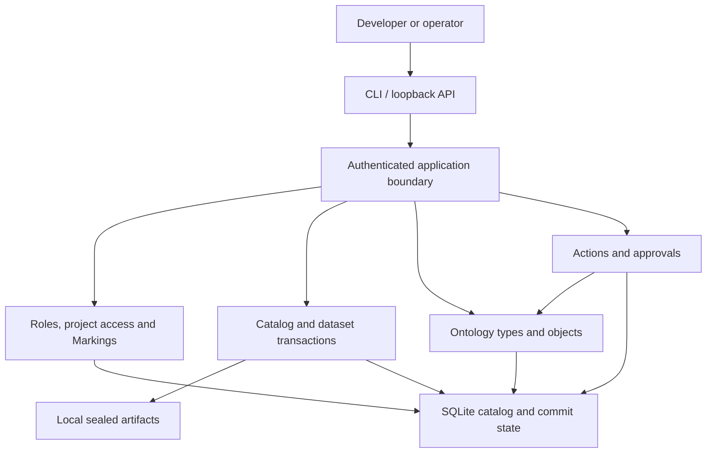
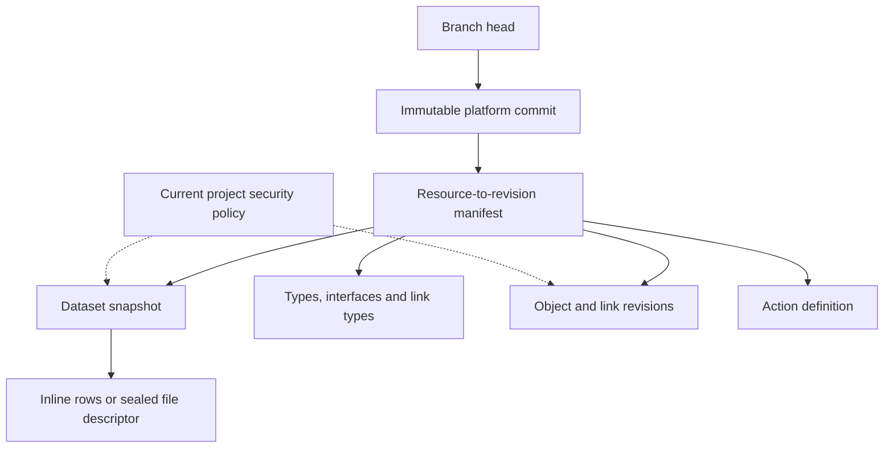

# Platform architecture

[Repository](../../README.md) · [Documentation index](../README.md) · [Technical overview](../TECHNICAL_OVERVIEW.md)

**Implementation covered:** v0.2.0, Gate 1 reference foundation.

## System boundary

S2 currently runs as one local Python application with a transactional SQLite catalog and optional local file storage. Its subsystem packages establish ownership boundaries inside that application. They are not independently deployed microservices in this release.



The application resolves identity from credentials, checks current permissions and coordinates writes. Callers do not select an arbitrary tenant. Direct Python internals, database access and warehouse file access are trusted host interfaces; the public development boundary is `Service.call` and its loopback HTTP adapter.

## Subsystem responsibilities

| Executable package | Owns | Depends on |
| --- | --- | --- |
| `s2_connector_fabric` | Bounded CSV/JSON preview, schema checks, APPEND and receipts | Catalog transactions, Ontology validation and governance |
| `s2_compute_pipelines` | Reviewed projection/filter execution, health checks and run receipts | Catalog, Ontology validation and governance |
| `s2_catalog_storage` | Dataset revisions, transactions, manifests, branch publication and file artifacts | Shared platform primitives and storage dependencies |
| `s2_governance_control` | Current principal authorization, roles, Markings and audit | Catalog connection provided by the application boundary |
| `s2_ontology_kernel` | Schema validation, interfaces, objects, links and filtered reads | Catalog and governance primitives |
| `s2_kinetic_actions` | Action definitions, approval decisions, effect validation and object edits | Ontology, governance and catalog transaction |
| `s2` | CLI, HTTP adapter, operation registry and project/branch orchestration | The six executable subsystems |
| `s2_platform` | Context, errors, canonical serialization and Marking primitives | Standard library |

The four remaining named subsystems are reserved for SDK generation, applications, analytics and AI. The [status matrix](../parity-matrix/gate1.md) tracks their remaining implementation scope.

## Branch-aware state



A fork initially shares its parent's immutable commit. Edits create new revisions and publish a new branch head. A merge compares the source, target and direct-fork base; conflicting same-resource changes require resolution. Dataset rows are not automatically merged across conflicting snapshots.

Identity, current authorization, approvals, invocation outcomes and audit records are operational state. They are not rewound by a branch operation. Live policy restrictions apply to older branches as well as the current main branch.

## File-backed commit flow

```mermaid
sequenceDiagram
    participant Caller
    participant S2 as S2 service
    participant DB as SQLite catalog
    participant Files as Local warehouse
    Caller->>S2: COMMIT prepared dataset transaction
    S2->>DB: Begin writer transaction
    S2->>S2: Authenticate and validate pinned input
    S2->>Files: Write a fresh artifact
    Files-->>S2: Data and metadata prepared
    S2->>Files: Seal, fsync and verify reader round-trip
    alt Preparation and validation succeed
        S2->>DB: Store descriptor, publish head, record outcome and audit
        S2->>DB: Commit
        S2-->>Caller: Committed snapshot and platform commit
    else Preparation or publication fails
        S2->>DB: Roll back
        S2-->>Caller: Failure; previous branch head retained
    end
```

No serving manifest points at an artifact until preparation and verification succeed. Files left by an interrupted attempt remain unreferenced and can be identified through the host-only storage report. The report does not delete them.

A response lost after catalog commit can be retried using the same transaction ID. The recorded outcome prevents a second logical commit. See the [storage protocol](file-storage.md) for durability ordering, full-copy behaviour and restore constraints.

## Action execution

Submission pins an Action revision, the complete branch head, target object revisions and a digest of the proposed effect. Where configured, distinct active administrators approve that effect; the submitter cannot self-approve.

Execution checks current submitter permission, reviewer eligibility, property types, allowed edits and the pinned state. All object revisions, branch publication and the successful audit entry share one catalog transaction. The current primitive supports internal property-set edits across at most 100 objects. User-code sandboxes and external write-back are later capabilities.

## Trust and deployment boundaries

| Boundary | Current treatment |
| --- | --- |
| Caller → application | Bearer authentication, current principal state, explicit operation registry |
| Tenant/project → resource | Scoped lookups, membership and role checks |
| Classification → read/write | Mandatory level/compartment checks, property redaction and live restriction floors |
| Application → files | Tenant-scoped references, sealed checksums, path and symlink validation |
| Application → physical systems | No external control or write-back in the reference release |
| Host administrator → stored data | Filesystem access remains trusted; data is plaintext at rest |

Cloud SaaS, dedicated VPC and air-gapped appliance deployment are target profiles. Before production deployment, the architecture needs qualified identity/key management, infrastructure isolation, resource limits, observability, backup/restore, HA and scale evidence. These are tracked development requirements rather than inferred guarantees of the current local runtime.
