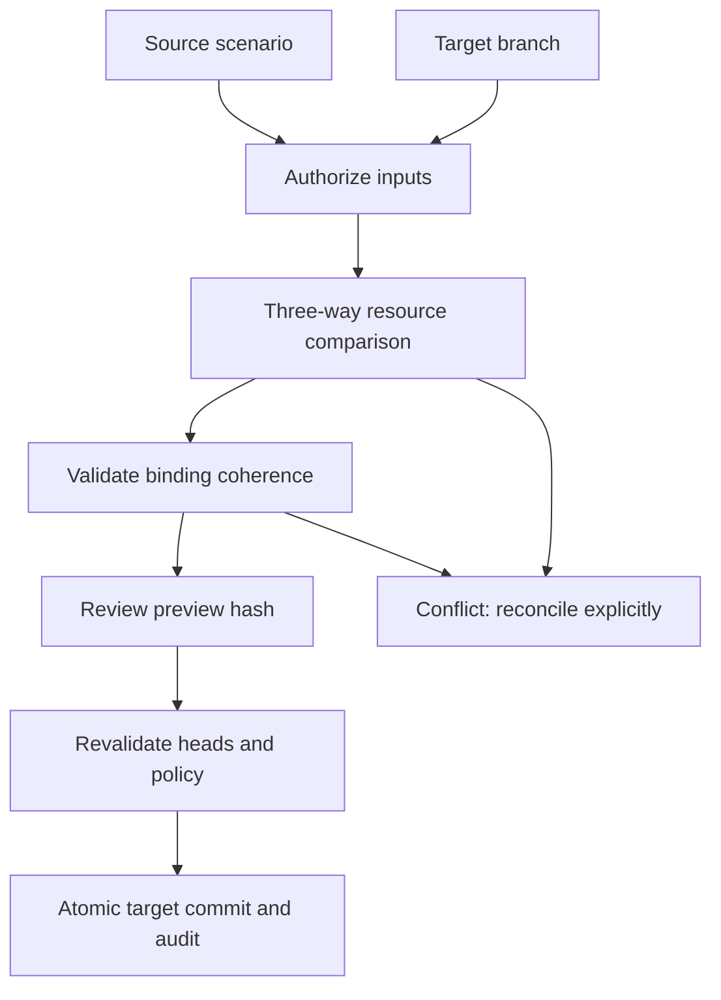

# Reviewed binding-aware branch merges

S2 v0.3.3 adds an administrator-only review and publication workflow to the local reference runtime. A scenario branch can publish coherent datasets, Ontology definitions, binding definitions and derived objects into a target branch without rebuilding or changing source identities.

## Contract and workflow

1. Fork the target and perform authorized scenario changes. Materialize changed datasets; explicitly migrate compatible changed schemas. Reconcile missing source records before merging.
2. Capture both branch heads and call `branches.merge_preview` with `branch`, `source`, `expected_head`, `expected_source` and a nonempty `reason` (maximum 1,000 characters).
3. Review the returned `changes` (resource keys and previous/proposed revision hashes), source/target commits, fork base and `plan_hash`.
4. Call `branches.merge_reviewed` with the exact preview parameters, `plan_hash` and a new `idempotency_key` (1–200 characters).
5. Publication creates one target commit with target and source heads as parents. The source branch remains unchanged. Retry the identical request to recover the same result.

The plan hash binds the actor, reason, heads, proposed manifest and effective policies. This is a review API: the caller must actually review the preview. It does not add a separate multi-party merge approval queue. Action approval remains its own workflow.



## Merge rules

| Situation | Result |
| --- | --- |
| Only source changes a resource | Adopt source revision |
| Only target changes a resource | Preserve target revision |
| Both branches have the same revision | Preserve it |
| Different objects changed independently | Combine if the resulting manifest is coherent |
| Same object changed differently | Conflict, even for different properties |
| Dataset refreshed in source, same bound object edited in target | Conflict; no silent overwrite |
| Source snapshot changed but objects were not materialized | Reject stale derived state |
| Compatible schema and binding migration completed in source | Accept if all merged schema/binding/object pins agree |
| Source row missing | Requires recorded reviewed retention against that snapshot |
| No changes to publish | Reject no-op |

## Integrity and authorization

All three input manifests are authorized before resource names or conflicts are disclosed. The merged manifest is also authorized. Current dataset row/column restrictions and source-dependent object markings apply, including restrictions introduced after the fork. Access is intentionally conservative: the caller needs access to the complete involved manifests.

Binding validation checks pinned schema/type revisions, owned object identity sets, mapped values, source snapshot freshness and retained absence observations. Each binding is bounded to 1,000 source rows and 1,000 owned objects. Existing Ontology manifest checks validate object/interface/link structure. Action definitions must reference existing writable properties.

Target publication, replay record and success audit share one SQLite transaction. Audit failure rolls back publication. Concurrent publications use expected-head checks; only one can win. Retries do not create additional commits, but reauthorize the pinned inputs and result under current policy. Each authorized API call may append an audit event.

## Scope and limits

This uses the source branch's original fork base, which must be an ancestor of both heads. It does not calculate a general best merge base, advance the fork base, rebase, or resolve criss-cross histories. Repeated integrations from a long-lived branch can conservatively conflict; use a fresh scenario fork for the next review cycle.

There is no row-level or property-level conflict resolution, resource deletion, identity migration, distributed publication, external write-back, or browser merge UI. The legacy `branches.merge` endpoint still rejects binding-bearing manifests; use these explicit reviewed endpoints. Source approval history remains audit history, not a branch-rewindable resource. A merge does not execute Actions or external effects.

No catalog format bump is needed: existing immutable revisions are reused. Service initialization adds a local `branch_merges` replay table. Existing v0.3.2 catalog formats remain readable.

## Demonstration

```bash
.venv/bin/python tooling/bindings_demo.py --storage iceberg --reconcile --migrate --merge
```

The synthetic demo records a separately approved annotation in a scenario and merges it while retaining the earlier approved inspection, source provenance and object identity. `--merge` includes the compatible migration needed for the annotation field. The temporary database is removed afterwards.

## Pipeline boundary introduced in v0.5.0

Both branch merge APIs reject pipeline-bearing manifests pending explicit pipeline-aware coherence validation. Non-pipeline reviewed merge behavior remains supported. See [pipeline scope](versioned-pipelines.md).
