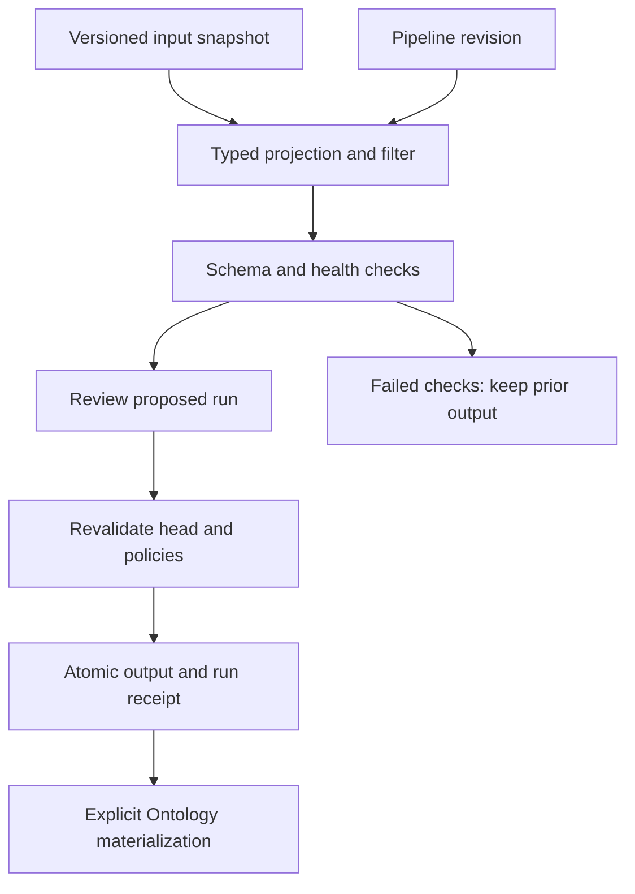

# Versioned pipelines — S2 v0.5.0

This is the first executable Compute & Pipelines slice in Samanvaya 2. The software release number v0.5.0 is independent of the separate Samanvaya 0.5/CNC product.

The local reference engine transforms one pinned input dataset snapshot into one output snapshot. Pipeline definitions are immutable revisions in the branch manifest. An administrator defines or revises a pipeline; an authorized writer previews and publishes a run. Source ingestion, pipeline execution and Ontology materialization remain explicit operations.



## Supported definition

```json
{
  "input": "raw",
  "output": "clean",
  "mappings": {"asset_id": "asset_id", "reading": "reading"},
  "filter": {"property": "accepted", "equals": true},
  "expectations": {
    "min_rows": 1,
    "max_rows": 1000,
    "ranges": {"reading": [0, 100]}
  }
}
```

Mapping keys are output properties and values are input properties. This supports projection and renaming, with identical declared scalar types. The output primary key must map to the input primary key. Required output properties must be mapped. A missing optional input that maps to a required output causes a run-health failure; it is not filled or silently dropped.

Use `filter: null` for all records. The only filter is typed equality against one input property. Missing properties fail the filter. Numeric ranges are inclusive and require the mapped property to be present. Empty output is permitted only when `min_rows` is zero. No expression evaluation, arbitrary Python, SQL, joins, aggregation, coercion or imputation is performed.

## Operations

| Operation | Role | Parameters and behavior |
| --- | --- | --- |
| `pipelines.define` | Admin | `branch`, `expected_head`, `pipeline`, `definition`; publishes a new immutable definition revision and pins input/output schema hashes |
| `pipelines.preview` | Writer | `branch`, `expected_head`, `pipeline`; returns pinned revisions, input/old-output/new-output counts, errors and `plan_hash` |
| `pipelines.run` | Writer | Preview parameters plus `plan_hash`, `idempotency_key`; atomically replaces the output snapshot and records the result |
| `pipelines.get` | Reader, original actor | `branch`, `run`; retrieves the committed receipt after current-policy checks |

Pipeline names use 1–100 letters, digits, dots, dashes or underscores. Input and output must be different, existing datasets. Revising a definition may change mappings, filter or expectations, but changing dataset identities requires a new pipeline name. Changed declared schemas require explicit redefinition; stale pinned schemas reject a run.

## Publication and recovery

**A successful run replaces all output rows.** Review the old and proposed row counts. This includes rows previously entered manually into that output; the output should be treated as a derived dataset. There is no automatic merge with output edits or implicit update of bound objects. Earlier output snapshots remain immutable and available through existing commit history.

Preview writes no dataset revision or branch commit, although the API appends an audit event. Output schema validation, numeric ranges and row counts must all pass. Error reports identify source record positions and failed checks without returning raw values. A failed preview reports `can_publish: false`; attempting publication fails without advancing the branch.

The plan hash binds the actor, branch head, pipeline revision, input/output revisions, proposed rows and effective policies. A changed head, plan or policy requires another preview. Output publication, run receipt and success audit share one local SQLite transaction. Audit/storage failure cannot publish a partial target. Physical files sealed before a failed catalog transaction may require the existing storage inventory/recovery process.

An identical retry with the same key returns the committed receipt without creating another snapshot. Receipt/replay access rechecks current policy; receipts are scoped to tenant, branch and original actor. Concurrent distinct requests against one head have one winning publisher. The `pipeline_runs` table records tenant, branch, run ID, actor, idempotency key, request hash and result.

## Provenance and classification

The output snapshot carries `source_pipeline`: pipeline name/revision, input dataset/revision, base commit, an aggregate classification and policy-resource dependencies. The receipt pins both the previous output and new output revisions. This supplies machine-readable lineage, not a graphical lineage explorer or independent signed attestation.

Classification is intentionally conservative. A run requires full schema and row access to both input and prior output. Aggregate output restrictions include input schema/properties, all input rows (even filtered rows), pipeline restrictions and prior output restrictions. Live source dataset/property/row floors are carried as dependencies. Empty output is protected too, because its existence and row count may be sensitive.

Dependencies propagate through subsequent pipeline stages and into newly materialized Ontology objects. A later source restriction therefore protects already-derived datasets and objects. Historical dependency unions are retained on replacement, preventing implicit declassification when filters change. This may over-restrict outputs; selective declassification and per-cell lineage are not implemented. Ordinary direct edits to an output retain its provenance restrictions.

## Branching and compatibility

Forks inherit pipeline revisions and isolate subsequent definition/run changes. **Both dataset-branch merge APIs reject manifests containing pipeline definitions in this slice.** General pipeline-aware merge validation is future work. This is an application-data branch boundary; Git merge/push workflows are unaffected. Existing non-pipeline branch merge behavior remains tested.

Defining the first pipeline advances the local catalog format to **6**, in the same transaction. Earlier runtimes must refuse the catalog because they do not enforce derived-dataset policy dependencies. Existing formats 1–5 remain supported by the new runtime. Keep a pre-upgrade database backup if you need to return to an older executable; a Git checkout alone does not downgrade a format-6 database. The demos use disposable databases.

## Bounds and remaining work

Input and existing output snapshots are limited to 1,000 rows each. This is a synchronous single-input/single-output engine. Multiple stages can be run explicitly; there is no DAG scheduler, automatic dependency execution, distributed worker, retry queue, visual Pipeline Builder, arbitrary user code, aggregation, remote compute or scale claim. Provenance cycles detected through materialized dependencies are rejected; this is not a general definition-graph planner.

For RCI/DRDO laboratory work, this slice can select accepted engineering records, project approved fields, enforce basic reading limits and feed traceable objects. Customer schemas, quality thresholds and classification rules remain separately agreed. Production qualification and full platform parity remain open.

## Demonstration

```bash
.venv/bin/python tooling/pipeline_demo.py --storage iceberg
```

The demo ingests two synthetic CSV records, selects the one marked accepted, checks its reading, publishes one clean record and materializes one Ontology object. It verifies replay/receipt equality, audit and storage references. It makes no external calls and removes the temporary database afterwards.
